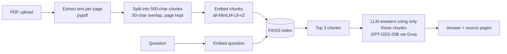

# Chat with your PDF — RAG built from scratch

Upload any PDF and ask questions about it in plain English. Every answer comes with the **page numbers it was taken from**, so you can check it against the document.

**Live demo:** https://huggingface.co/spaces/sriharsha1414/RAG

The whole retrieval pipeline is written by hand — **no LangChain or LlamaIndex** — so every step is visible and easy to change.

## How it works



1. **Read** – `pypdf` pulls the text out of each page.
2. **Chunk** – text is cut into 500-character pieces with a 50-character overlap, so a sentence split across two chunks still shows up whole in one of them. Each chunk remembers its page number.
3. **Embed** – each chunk becomes a 384-number vector using the `all-MiniLM-L6-v2` Sentence-Transformers model.
4. **Index** – vectors go into a FAISS `IndexFlatL2` for fast similarity search.
5. **Retrieve** – the question is embedded the same way and the 3 closest chunks are found.
6. **Generate** – the LLM is told to answer *only* from those chunks, which keeps it grounded.
7. **Cite** – the pages of the retrieved chunks are shown under the answer.

## Tech stack

| Part | Tool |
|---|---|
| UI | Streamlit |
| PDF text | pypdf |
| Embeddings | Sentence-Transformers (`all-MiniLM-L6-v2`) |
| Vector search | FAISS |
| LLM | GPT-OSS-20B on Groq (configurable) |
| Deployment | Docker on Hugging Face Spaces |

## Problems I hit and fixed

Getting this live taught me more than building it:

- **Dependency conflicts** while building the Docker image.
- **File uploads failing** on Hugging Face Spaces because of Streamlit's CORS/XSRF checks behind the Spaces proxy — fixed with server flags in the Dockerfile.
- **Vector-shape mismatch** that broke FAISS search — added a check that embeddings are 2-D before indexing.
- **Scanned PDFs with no text** — the app now shows a clear message instead of crashing.
- **Model retirement** — Groq shut down Llama 3.1 in August 2026. I migrated to GPT-OSS-20B and moved the model name into an environment variable (`GROQ_MODEL`) so the next change needs no code edit.
- **Noisy startup logs** from Streamlit's file watcher scanning unused Transformers modules — turned off with `fileWatcherType = "none"`.

## Run it locally

```bash
git clone https://github.com/Harshamaringanti48/rag-pdf-chatbot.git
cd rag-pdf-chatbot
python -m venv .venv
# Windows: .venv\Scripts\activate    Mac/Linux: source .venv/bin/activate
pip install -r requirements.txt
```

Get a free API key at [console.groq.com](https://console.groq.com), then create `.streamlit/secrets.toml`:

```toml
GROQ_API_KEY = "your-key-here"
```

Start the app:

```bash
streamlit run src/streamlit_app.py
```

Optional: set `GROQ_MODEL` (for example `openai/gpt-oss-120b`) to use a different model.

### Or with Docker

```bash
docker build -t rag-pdf-chatbot .
docker run -p 8501:8501 -e GROQ_API_KEY=your-key-here rag-pdf-chatbot
```

Then open http://localhost:8501.

## Limitations and next steps

- Scanned (image-only) PDFs aren't supported yet — adding OCR would fix this.
- The index lives in memory for one session; a vector database would let documents persist.
- Next: an evaluation set of question/answer pairs to measure answer accuracy, and a FastAPI endpoint so other apps can use the pipeline.

## Author

**Sri Harsha Maringanti** — M.S. Computer Science, Auburn University at Montgomery
[LinkedIn](https://www.linkedin.com/in/sri-harsha-maringanti/) · [GitHub](https://github.com/Harshamaringanti48)
